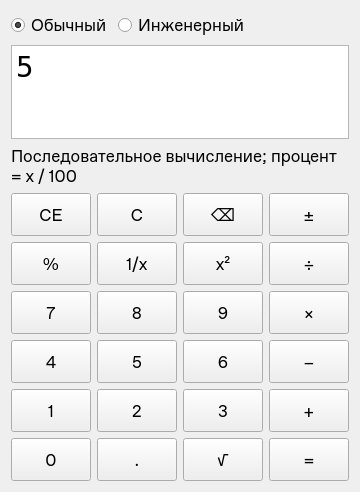
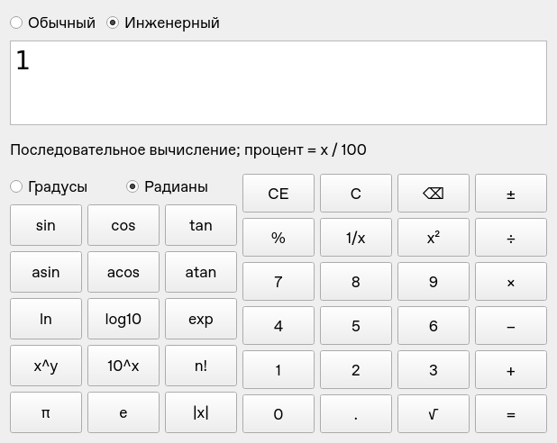

# ЛР №2 — калькулятор на Qt

Папка `lab2_sem1` названа по запросу пользователя. Методичка относится к ЛР №2
второго семестра: двухрежимный калькулятор на Qt.

Программа создаёт интерфейс полностью на C++, без QtDesigner и `.ui`.
При запуске выбран обычный режим. Переключение RadioButton показывает/скрывает
инженерную панель, меняет ширину и заголовок окна, сохраняя текущий расчёт.
Вывод — `QPlainTextEdit` с моноширинным шрифтом; размещение — layouts.

| Обычный режим | Инженерный режим |
|---|---|
|  |  |

Это снимки собранного приложения Qt 5.15.15 на Linux. Оформление системных
элементов на macOS и Windows будет соответствовать стилю установленной Qt.

## Что реализовано

Обычный режим: четыре арифметические операции, ввод десятичных чисел, смена знака,
квадрат, корень, обратное число, процент, CE, C, удаление последней цифры.

Инженерный режим дополнительно предоставляет `sin`, `cos`, `tan`, `asin`, `acos`,
`atan`, `ln`, `log10`, `exp`, `x^y`, `10^x`, факториал, модуль, pi и e, а также
переключение между градусами и радианами. По умолчанию выбраны градусы.

Клавиатура: цифры, `.` или `,`, `+`, `-`, `*`, `/`, `=` или Enter, Backspace,
Escape (C), Delete (CE). Инженерные функции выбираются кнопками.

Важные правила работы:

- Вычисление последовательное, как у простого калькулятора: `2 + 3 * 4 =` даёт 20.
  Разбора формул, скобок и приоритета операций нет.
- Повторное `=` повторяет последнюю двоичную операцию. После `2 + 3 =` получаем 5,
  следующее `=` даёт 8. Ввод нового числа сбрасывает повтор.
- Если второй аргумент не введён, используется отображаемое число: `5 + =` даёт 10.
- Повторный выбор операции до ввода второго числа заменяет ожидающую операцию.
- CE очищает текущий ввод, сохраняя ожидающую операцию. C сбрасывает весь расчёт.
- Процент — `x / 100`. Например, для увеличения 200 на 10% можно ввести `200 * 1.1 =`.
  Контекстная финансовая трактовка кнопки `%` не реализуется.
- После результата новая цифра начинает новый ввод. Backspace после результата
  очищает текущий ввод; во время набора удаляет последнюю цифру.
- При вводе допускается до 16 цифр, результат отображается с 15 значащими цифрами.
  Вычисления выполняются в `double`, поэтому возможна обычная погрешность округления.

Проверяются деление на ноль, корень отрицательного числа, аргументы логарифмов и
обратных тригонометрических функций, неопределённый тангенс, степень и переполнение.
Факториал определён для целого аргумента от 0 до 170; 0! = 1. Политика для 0^0 —
сообщение о недопустимой степени. При ошибке новое число или C начинает новый расчёт.

## Сборка в Qt Creator

1. Установить Qt с модулем Widgets и компилятором для своей ОС.
2. Открыть файл `lab2_sem1.pro` в Qt Creator.
3. Выбрать Desktop Kit, собрать и запустить проект.

Предусмотрены Qt 5.15 и Qt 6. Для Qt 5 проект использует C++11. Qt 6 требует
режим компиляции C++17, поэтому qmake выбирает его автоматически; дополнительных
возможностей языка C++17 в исходниках нет. Реальная сборка в этой работе проверена
на Qt 5.15.15/Linux; запуск на macOS и Qt 6 в данной среде не проверялся.

## Терминал macOS

Если Qt ещё не установлен, его можно установить через Homebrew:

```sh
brew install qt
```

Находясь в `UNI/lab2_sem1`, выполнить:

```sh
mkdir -p build
cd build
"$(brew --prefix qt)/bin/qmake" ../lab2_sem1.pro
make
open lab2_sem1.app
```

Если Qt установлен через официальный установщик, использовать путь к `qmake`
выбранного Desktop Kit. Если `qmake` уже доступен в PATH, достаточно `qmake`.

## Терминал Linux

Нужны Qt Widgets development files, qmake и компилятор C++.
Из `UNI/lab2_sem1`:

```sh
mkdir -p build
cd build
qmake ../lab2_sem1.pro
make
./lab2_sem1
```

В некоторых установках Qt 6 команда называется `qmake6`.

## Тесты

Тесты — отдельный qmake-проект, без дополнительного тестового фреймворка.
Из `UNI/lab2_sem1`:

```sh
mkdir -p build-tests
cd build-tests
qmake ../tests/tests.pro
make
./calculator_tests
```

На macOS с Homebrew заменить `qmake` на `"$(brew --prefix qt)/bin/qmake"`.
Здесь `make` собирает именно тестовый проект; команда `make tests` не используется.

Для Linux без графического экрана:

```sh
QT_QPA_PLATFORM=offscreen ./calculator_tests
```

Необязательный аргумент задаёт каталог снимков экрана:

```sh
QT_QPA_PLATFORM=offscreen ./calculator_tests ./screenshots
```

Проверяются арифметика и состояние расчёта, редактирование ввода, инженерные функции,
области определения, переполнение и восстановление после ошибок. Проверки настоящего
виджета нажимают кнопки, переключают режим/единицы угла и сравнивают ширину окна,
заголовок, содержимое поля и реакцию на клавиатуру. Снимки снимаются с этого же окна.

## Структура и подготовка к показу

| Файл | Назначение |
|---|---|
| `PLAN.md` | Предварительный разбор требований, лекций и план |
| `calculation.h/.cpp` | Состояние ввода, арифметика, инженерные функции и ошибки |
| `calculator.h/.cpp` | Программное создание виджетов, layouts, сигналы/слоты, клавиатура |
| `main.cpp` | QApplication, создание окна, цикл событий |
| `lab2_sem1.pro` | Сборка приложения через qmake |
| `tests/tests.pro`, `tests/tests.cpp` | Проверки вычислений и интерфейса |

Для демонстрации: запустить обычный режим, проверить `12.5 + 7.5 = 20`, выбрать
инженерный режим, вычислить `sin(30)` в градусах и `5!`, затем показать ошибку `1/0`
и восстановление вводом цифры. Вернуться в обычный режим и показать уменьшение окна.
Связь реализации с ранее разобранными лекциями и границы доступности оригинальных
вложений описаны в `PLAN.md`.
